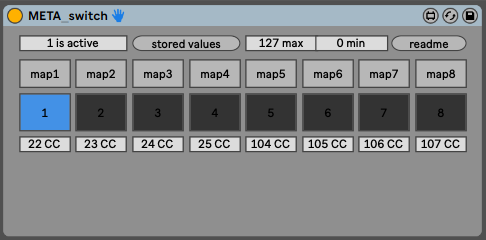

This patch is part of the [_META_ Environment](https://bitbucket.org/AdrianArtacho/meta4live/src/master/).

# META_switch

This device switches between up to 8 different toggles (activating one, will deactivate the others).

### 

### Credits

Reference...

---

# To-Do

- Documentation