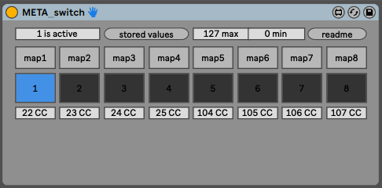

This patch is part of the [_META_ Environment](https://bitbucket.org/AdrianArtacho/meta4live/src/master/).

# META_switch

This README would normally document whatever steps are necessary to get your application up and running. 

### 

### Credits

Reference...

---

# To-Do

- Documentation